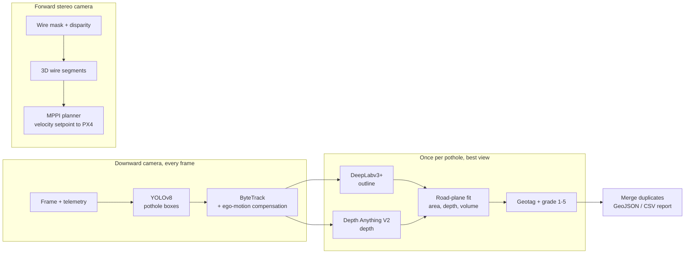

# SkyTrack

Pothole inspection from a drone. The drone flies a road at about 10 m, finds potholes in the downward camera, measures each one (area, depth, volume), tags it with GPS coordinates, and grades it for repair. A forward stereo camera watches for overhead cables, and an MPPI planner steers around them.


The output of a flight is a GeoJSON file with one point per pothole, sorted by repair priority, that opens directly in QGIS.

## How it works



The reasoning behind each model, and the alternatives that were ruled out, is in [docs/model-choices.md](docs/model-choices.md).

A few parts are worth calling out because the obvious approach does not work:

**Tracking needs the drone's motion.** At 5 m/s and 10 fps the road moves about 55 px between frames, more than most potholes are wide, so plain IoU tracking loses every pothole after one frame. Before each update, `ByteTracker.compensate` moves every track by the motion the telemetry predicts (pixel, to road point at the previous pose, to pixel at the current pose). `tests/test_pipeline.py` checks both cases: with compensation every pothole is reported once, without it potholes go missing.

**Measure against the road, not against the drone.** The road surface is fitted with RANSAC on a ring of pixels around the pothole, and depth, area and volume are all measured relative to that plane. A wrong altitude or a slightly tilted camera then affects the road and the pothole floor equally and largely cancels out.

**Depth models are not metric at a new altitude.** `align_depth` corrects the depth model against the depth the pose predicts for the surrounding road. For a relative depth model that also means fitting a scale, which is impossible when looking straight down at a flat road (every road pixel has the same depth). In that case the code raises an error instead of returning a confident wrong answer.

**Thin wires break per-pixel stereo.** Most pixels on a 1-2 px cable have no valid disparity. Along the image of a straight 3D line, disparity changes linearly, so `wires.py` fits a robust line to whatever disparity values survive and reads the depth at both ends from the fit.

## Results

### Measurement chain on synthetic flights

`python scripts/simulate_flight.py --flights 3` ray-traces nadir flights over 120 m of road with 12 potholes of known size, runs the full pipeline, and compares the report with ground truth. The logged telemetry is perturbed the way real flight logs are: a GPS offset that stays fixed for the flight, plus jitter, altitude error and attitude error. Images are rendered with the true pose.

The detector, segmenter and depth model are stand-ins here (true boxes with jitter, 10 % misses and false positives; a threshold segmenter; true depth with ±5 % scale error, bias and noise). So these numbers check the geometry, tracking, measurement and de-duplication code, not the trained models.

3 flights × 12 potholes per telemetry setting:

| Telemetry | Recall | Extra records | Geolocation error, mean / p95 | Area error | Max-depth error | Volume error | Grade matches truth |
|---|---|---|---|---|---|---|---|
| RTK GPS | 1.00 | 0 | 0.05 / 0.09 m | 0.6 % | 2.1 mm | 3.0 % | 94 % |
| Standard GPS | 0.89 | 0 | 0.54 / 1.06 m | 5.8 % | 2.2 mm | 6.9 % | 94 % |

Potholes are matched to ground truth after removing the flight's GPS offset; the geolocation column still includes it.

With RTK the geolocation error is a few centimetres. With standard GPS it is dominated by the receiver's own offset, which image processing cannot remove; for a repair crew that is still the right lane and the right metre. The four potholes missed under standard GPS were all small (under about 0.6 m across): 0.15 m of frame-to-frame position jitter is around 16 px, enough to break track association on a box that size before a clean view gets measured. Depth error mostly comes from the depth model's scale error, which passes straight through to pothole depth.

### Wire avoidance

`python scripts/benchmark_planner.py`: fly 40 m north at 10 m with cables placed across the path. Safety radius 1 m, 512 samples, 1.5 s horizon, perfect state feedback.

| Scenario | Reached goal | Closest approach to a wire | Min altitude | Plan rate |
|---|---|---|---|---|
| No wires | yes | n/a | 10.0 m | 356 Hz |
| One cable at flight height | yes | 1.98 m | 10.0 m | 307 Hz |
| Cable 0.5 m below flight height | yes | 2.13 m | 10.0 m | 303 Hz |
| Two stacked cables 1 m apart (9.5 m, 10.5 m) | yes | 1.81 m | 10.0 m | 190 Hz |
| Two stacked cables 2 m apart (9 m, 11 m) | yes | 1.00 m | 9.9 m | 191 Hz |
| Sagging cable, lowest point at 10 m | yes | 1.98 m | 10.0 m | 98 Hz |
| Two cables 6 m apart along the path | yes | 2.11 m | 10.0 m | 184 Hz |

Plan rate is pure NumPy on a 2-core cloud CPU. With two cables exactly 2 m apart, the planner squeezes between them with exactly the 1 m margin, which the cost function allows. In practice the safety radius should include the wire position uncertainty from stereo, which grows with range.

### Not yet measured

The trained models themselves. Fine-tuning YOLOv8 on RDD2022 needs a GPU (`scripts/train.py` writes `runs/rdd2022/summary.json` with mAP on the validation split), and Jetson latency needs the hardware. Neither is claimed here.

## Usage

```bash
pip install -e ".[onnx]"

skytrack inspect flight.mp4 telemetry.csv \
    --detector yolov8s-rdd.onnx --segmenter deeplabv3p.onnx --depth depth_anything_v2_metric.onnx \
    --focal-mm 4.5 --sensor-width-mm 6.17 --out report
```

`telemetry.csv` has one row per frame: `frame,lat,lon,alt_agl,yaw_deg,pitch_deg,roll_deg`. The command writes `report.geojson` and `report.csv`.

From Python:

```python
from skytrack import InspectionPipeline, Intrinsics, Pose
from skytrack.detectors import OnnxDetector
from skytrack.models import OnnxDepth, OnnxSegmenter

intr = Intrinsics.from_sensor(focal_mm=4.5, sensor_width_mm=6.17, width=1920, height=1080)
pipe = InspectionPipeline(intr, OnnxDetector("yolov8s-rdd.onnx", conf=0.1), OnnxSegmenter("deeplabv3p.onnx"),
                          OnnxDepth("depth_anything_v2_metric.onnx"), origin=(17.4474, 78.3762))
for frame, pose in flight:          # pose: Pose(east, north, alt, yaw, pitch, roll) in metres / radians
    pipe.process(frame, pose)
for p in pipe.results():
    print(p.lat, p.lon, p.grade, p.measurement.volume_m3)
```

Training the detector:

```bash
pip install -e ".[train]"
python -m skytrack.rdd2022 /data/RDD2022 /data/rdd-yolo --countries India Japan Czech Norway
python scripts/train.py --data /data/rdd-yolo/rdd2022.yaml --model yolov8s.pt --export-onnx
```

## Code

| Module | What it does |
|---|---|
| `geometry.py` | Camera model, pixel-to-road projection with full attitude, GPS conversion |
| `tracking.py`, `kalman.py` | ByteTrack and a Kalman filter, plus ego-motion compensation |
| `tiling.py` | Sliced inference for small potholes at higher altitude |
| `measure.py` | Depth alignment, RANSAC road plane, area / length / width / depth / volume |
| `severity.py` | Rule-based 1-5 grade (FHWA depth bands) and an ONNX wrapper for the learned classifier |
| `pipeline.py` | Per-frame loop: detect, track, pick the best view, measure, geotag, merge duplicates |
| `wires.py` | 3D wire segments from a wire mask and stereo disparity |
| `planner.py` | MPPI planner and the PX4 velocity setpoint |
| `detectors.py`, `models.py` | ONNX Runtime wrappers for YOLOv8, DeepLabv3+, Depth Anything V2 |
| `rdd2022.py` | RDD2022 Pascal VOC to YOLO converter |
| `road_sim.py` | Ray-traced synthetic road flights used by the tests and the simulation script |
| `metrics.py` | mAP, MOTA and IDF1, used for the tracker benchmark |

## Development

```bash
pip install -e ".[dev]"
pytest                               # 61 tests, ~15 s, no GPU or dataset needed
ruff check src tests scripts
python scripts/benchmark_planner.py
python scripts/benchmark_trackers.py # why ByteTrack: ablation against IoU and SORT trackers
```

## Limitations

- Two potholes closer than the merge radius (1 m) are reported as one.
- The road is treated as locally flat. Steep camber or a pothole on a hill crest will bias depth.
- Standard GPS limits geolocation to about a metre. RTK, or matching against the previous flight's map, fixes that.
- The wire map is per-frame. Fusing wires across frames would make the planner's picture of the scene steadier.

## License

MIT. RDD2022 and TTPLA are distributed under their own terms.
