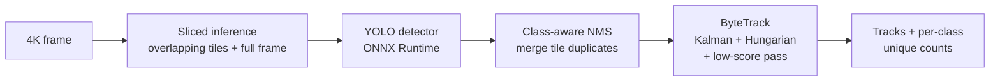

# SkyTrack

Small-object detection and multi-object tracking for drone video. Fine-tunes YOLO on [VisDrone](https://github.com/VisDrone/VisDrone-Dataset), recovers tiny objects with sliced inference, tracks them with a from-scratch ByteTrack implementation, and deploys through ONNX Runtime.


## The problem

Aerial footage breaks the assumptions of ground-level detectors:

- **Objects are tiny.** Most VisDrone objects are under 32 px. Resize a 4K frame to a 640 px network input and a 20 px pedestrian becomes ~3 px, below what the backbone can resolve.
- **Objects are dense and look alike.** Dozens of near-identical cars in one frame make identity tracking hard.
- **Detections flicker.** Partial occlusion by trees or bridges drops confidence for a few frames, and naive trackers delete the track.

## What is in here



| Module | Implemented from scratch | Purpose |
|---|---|---|
| `tiling.py` | Tile grid, coordinate shift, merge | Run the detector at native resolution on 640 px tiles |
| `kalman.py` | Constant-velocity Kalman filter on (cx, cy, aspect, h) | Predict where each object will be; noise scales with box height |
| `tracking.py` | ByteTrack association + a naive IoU baseline | Keep identities through crossings and occlusions |
| `metrics.py` | COCO mAP@0.5 / 0.5:0.95, MOTA, IDF1 | Evaluate without external toolkits |
| `detectors.py` | Letterbox, YOLOv8/11 head decoding | ONNX Runtime deployment with no PyTorch dependency |
| `visdrone.py` | Annotation converter | VisDrone → YOLO labels, dropping ignored regions |

## Results

### Sliced inference recovers objects the full-frame pass cannot see

`tests/test_boxes_tiling.py` places 30 objects of 20 px in a 3840×2160 frame and uses a simulated detector that, like a real CNN, only sees the image after downscaling to 640 px and cannot resolve objects under 8 px:

| | Recall |
|---|---|
| Full frame | 0.00 |
| Sliced (640 px tiles, 20 % overlap) + full frame | ≥ 0.90 (asserted in CI) |

### Tracker ablation

`python scripts/benchmark_trackers.py` runs 10 synthetic aerial scenes (300 frames, 25 small objects each, with detector jitter, 8 % misses, occlusion episodes with low confidence, and false positives). Mean over scenes:

| Tracker | MOTA ↑ | IDF1 ↑ | ID switches ↓ | ms / frame |
|---|---|---|---|---|
| IoU tracker (greedy, no motion model) | 0.651 | 0.308 | 256.2 | 0.09 |
| SORT (Kalman, no low-score pass) | 0.683 | 0.456 | 83.5 | 0.64 |
| **ByteTrack (Kalman + low-score pass)** | **0.763** | **0.548** | **64.5** | 0.77 |

Each component earns its place. The Kalman filter cuts identity switches by two thirds by predicting position instead of assuming objects stay put. The low-score second pass adds 8 points of MOTA by keeping tracks alive through occlusion instead of dropping them.

**What the remaining errors say.** IDF1 is still modest because IoU is a poor similarity for small, fast objects: a 15 px car moving 8 px per frame barely overlaps its own predicted box. That is the main open problem in aerial tracking and the next step for this repo (see below).

### Detector on VisDrone

Fine-tuning needs a GPU. Run it on a free Colab or Kaggle T4:

```bash
pip install -e ".[train]"
python -m skytrack.visdrone /data/VisDrone /data/visdrone-yolo
python scripts/train.py --data /data/visdrone-yolo/visdrone.yaml --model yolo11s.pt --imgsz 1024 --export-onnx
```

`scripts/train.py` writes `runs/visdrone/summary.json` with mAP@0.5 and mAP@0.5:0.95 on the validation split. Then measure the cost of slicing on your hardware:

```bash
python scripts/benchmark_latency.py --weights best.onnx --image frame.jpg --tile 640
```

## Usage

```bash
pip install -e ".[onnx]"

# annotated video + unique object counts per class
python -m skytrack.video drone_clip.mp4 --weights best.onnx --tile 640 --out tracked.mp4
```

```python
from skytrack import ByteTracker, sliced_predict
from skytrack.detectors import OnnxDetector

detector = OnnxDetector("best.onnx", imgsz=640, conf=0.1)  # keep low scores: ByteTrack uses them
tracker = ByteTracker()
for frame in frames:
    for track in tracker.update(sliced_predict(frame, detector, tile=640)):
        print(track.id, track.cls, track.box)
```

## Development

```bash
pip install -e ".[dev]"
pytest                    # 29 tests, < 1 s, no GPU or dataset needed
ruff check src tests scripts
python scripts/benchmark_trackers.py
```

## Next steps

- **Distance-aware association:** combine IoU with normalised centre distance (as in OC-SORT / BoT-SORT) so small fast objects still match their predictions.
- **Camera motion compensation:** drones pan and rotate; estimate a homography between frames with ORB features and warp track predictions before matching.
- **Slicing only where needed:** skip tiles over sky or empty fields using a cheap low-resolution pass, to cut the latency cost of slicing.

## License

MIT. VisDrone is distributed under its own terms for research use.
